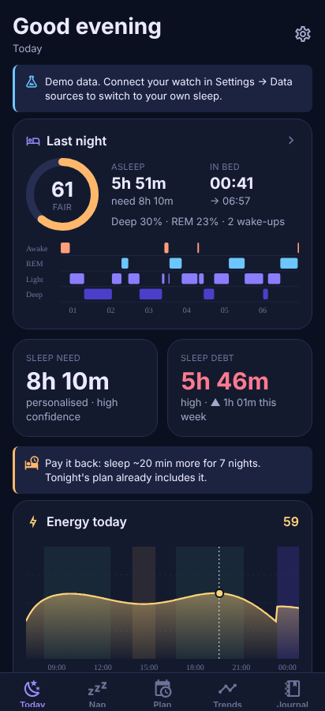
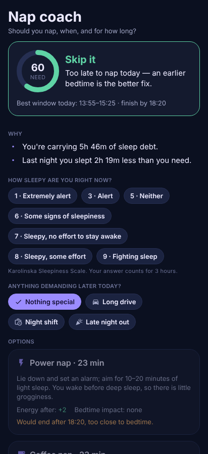
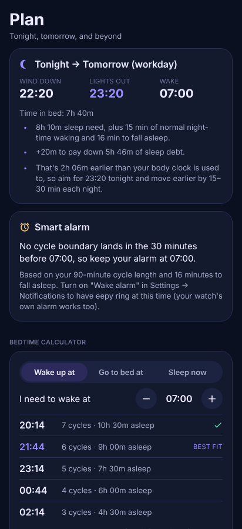
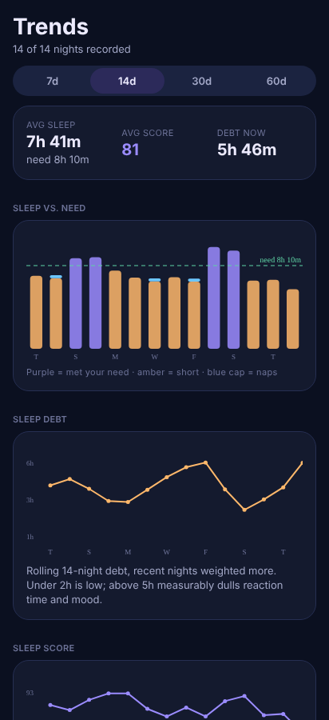
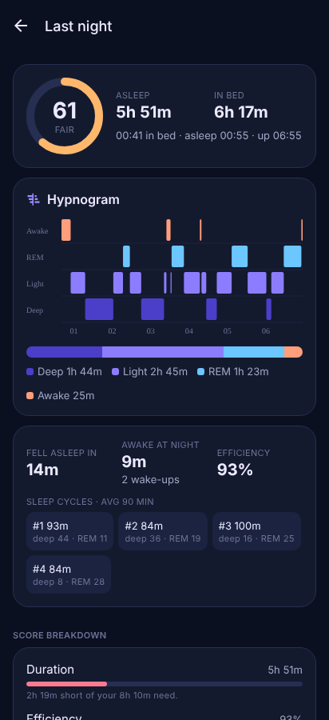
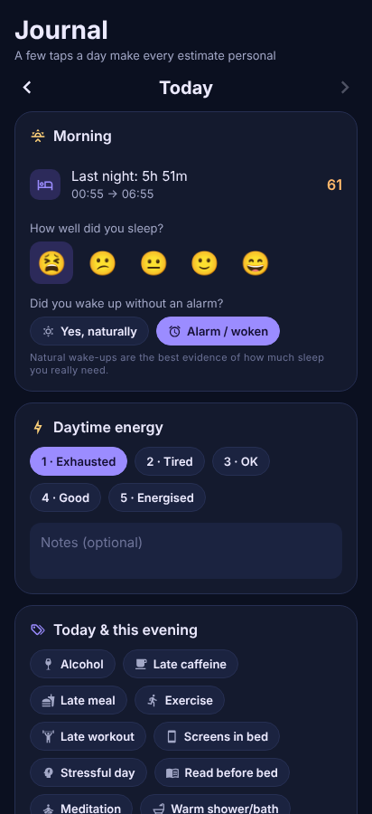

# eepy 🌙

A sleep coach for Android that works with the **CMF Watch 3 Pro**. It answers the questions a sleep tracker usually leaves to you:

- **How much sleep do I actually need?** — learned from the nights you wake up without an alarm, corrected for rebound sleep, combined with your age-group guideline and (optionally) how energetic you feel.
- **How far behind am I?** — a 14-night sleep-debt tally and a concrete plan to pay it back.
- **Do I need a nap — when, and how long?** — a nap coach that simulates each option's energy boost and its effect on tonight's sleep.
- **When should I go to bed, stop caffeine, and set my alarm?** — tonight's plan, a cycle-timed alarm, a caffeine cut-off and an hour-by-hour energy forecast.
- **What helps or hurts my sleep?** — personal, statistically tested insights from your journal tags.

The full, detailed feature list (built ✅ / to verify on-device 🧪 / planned 🗺️) is in **[FEATURES.md](FEATURES.md)**.

| Today | Nap coach | Plan | Trends | Night | Journal |
| --- | --- | --- | --- | --- | --- |
|  |  |  |  |  |  |

*(Screenshots use the built-in demo data.)*

## Install the APK

1. Open the repository's **Releases** page on your phone (or the latest run under **Actions → Android APK → Artifacts**).
2. Download `eepy-<version>-build<N>.apk`.
3. When Android asks, allow your browser to *install unknown apps*, then install.
4. Open eepy → follow the onboarding → **Connect CMF Watch**.

Every push to the repository builds a fresh APK (`.github/workflows/android-apk.yml`). Builds are signed with the same debug key, so new versions install over old ones and keep your data. The APK targets arm64 phones (every modern Android phone).

## Connecting your CMF Watch 3 Pro

The watch has no public SDK, and pairing it directly would fight Nothing X over Bluetooth. Instead:

```
CMF Watch 3 Pro ──Bluetooth──▶ Nothing X ──▶ Health Connect ──▶ eepy
```

1. **Health Connect** — built into Android 14+; on Android 9–13 install it from the Play Store.
2. **Nothing X** (the companion app for the CMF Watch 3 Pro) → your watch → turn on Health Connect sharing for Sleep, Heart rate, Heart rate variability, Blood oxygen, Respiratory rate and Steps. You can double-check under Health Connect → App permissions → Nothing X.
3. **eepy** → Connect screen → *Grant permissions* → *Sync now*. eepy imports your history and re-syncs whenever you open it.

eepy's Connect screen ticks off the Nothing X step by itself once it finds sleep from Nothing X (`com.nothing.smartcenter`) in Health Connect. If last night is missing, open Nothing X and let it sync the watch first, and exclude Nothing X from battery optimisation.

## How it works

```
src/
  engine/          Pure TypeScript sleep science (no React, fully unit-tested)
    sessions.ts      stage cleanup, latency/WASO/efficiency, cycle detection, dedupe, nap vs. main sleep
    sleepNeed.ts     age prior + debt-corrected natural nights + energy dose–response → personal need
    sleepDebt.ts     14-night weighted debt, payback simulation
    alertness.ts     three-process energy forecast; two-process sleep pressure for nap/bedtime effects
    nap.ts           nap need score, timing, option simulation, verdict
    schedule.ts      tonight's plan, bedtime calculator, cycle-timed alarm, schedule shifting
    jetlag.ts        day-by-day light & sleep plan across time zones
    caffeine.ts      absorption/elimination model and cut-off
    chronotype.ts    MCTQ chronotype, social jet lag, body-clock markers
    regularity.ts    Sleep Regularity Index
    sleepScore.ts    transparent 0–100 score
    vitals.ts        overnight HR/HRV/SpO2 summaries, readiness
    insights.ts      Welch's t-tests over journal tags and habits
    coach.ts         daily timeline and prioritised tips
    analysis.ts      runs everything for "now"
    demo.ts          realistic synthetic data
  integrations/    Health Connect bridge + pure record mappers, JSON backup
  state/           zustand store (persisted on-device), sync, notifications
  ui/              theme, components, SVG charts
  app/             Expo Router screens
```

All data stays on the phone. There is no account and no server.

## Develop

Requirements: Node 22, and for native builds JDK 17 + Android SDK (or let GitHub Actions build the APK).

```bash
npm install
```

```bash
npm test            # engine + integration unit tests
```

```bash
npm run typecheck
```

```bash
npm run web         # quick UI preview in a browser (use Settings → Load demo data)
```

```bash
npx expo run:android   # build and run on a connected phone/emulator (Health Connect needs a real device or a Play-enabled emulator)
```

Expo Go can't load Health Connect; use `expo run:android` or the CI APK.

## Disclaimer

eepy is a wellness tool, not a medical device. Wrist-based sleep staging is an estimate, and the questionnaires are screening aids, not diagnoses. If you snore loudly, stop breathing during sleep, or are very sleepy despite enough sleep, see a doctor.
